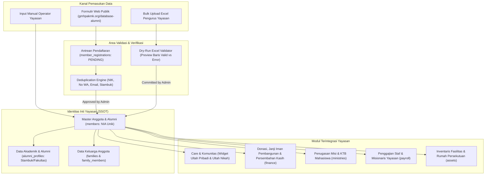
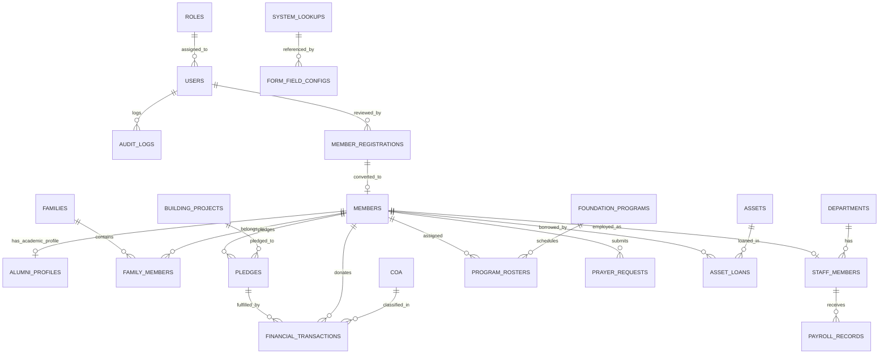
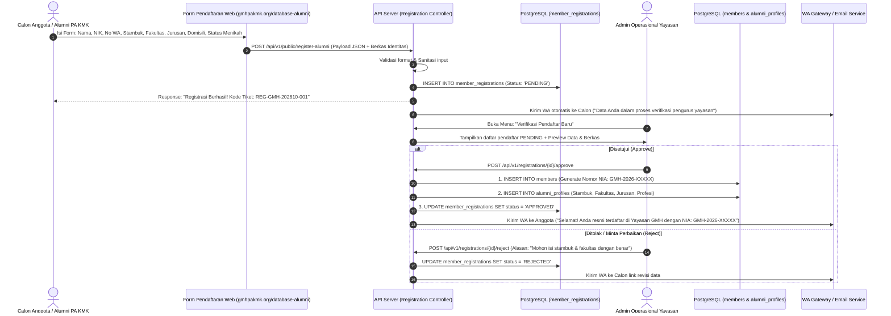
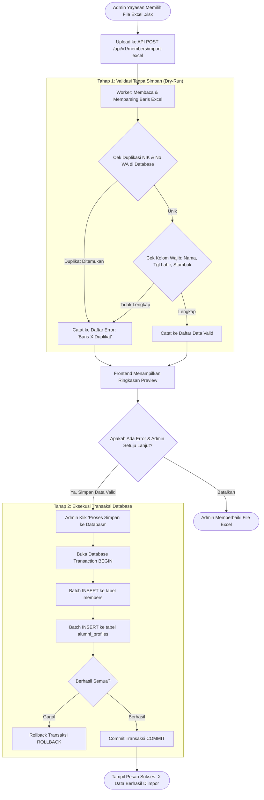
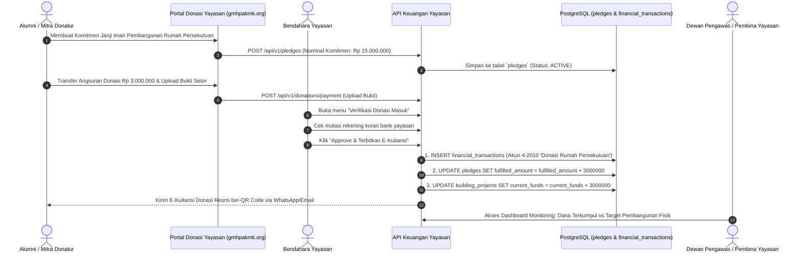
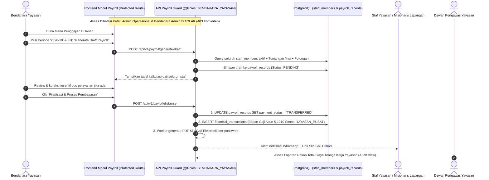
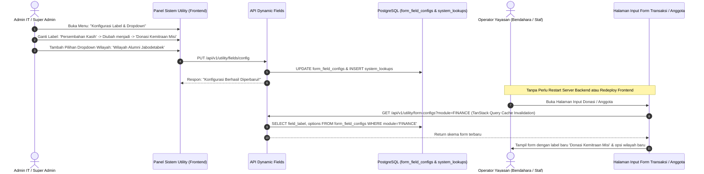

# KNOWLEDGE BASE: INTEGRASI DATA, DESAIN DATABASE & FLOW SISTEM YAYASAN
**Entitas:** Yayasan Global Mission House (GMH) & PA KMK ([gmhpakmk.org](https://gmhpakmk.org/))  
**Kategori Organisasi:** Yayasan Non-Gereja (Christian Non-Profit Foundation, Alumni Fellowship & Mission House)  
**Pola Arsitektur:** Monolit Modular (Web UI `apps/web` + Backend API `apps/api`)  
**Versi Dokumen:** 2.1 (Pure Foundation Edition - Non-Gereja)  
**Tanggal:** 2026-10-30  

---

## 1. Profil & Karakteristik Yayasan GMH PA KMK ([gmhpakmk.org](https://gmhpakmk.org/))

Yayasan Global Mission House (GMH PA KMK) adalah **organisasi yayasan nirlaba non-gereja**. Yayasan ini menjadi payung hukum dan pusat pergerakan pelayanan bagi alumni Kristen (PA KMK USU), pembinaan mahasiswa kampus, pengutusan misi ke daerah, dan pembangunan fasilitas Rumah Persekutuan.

```
                       ┌─────────────────────────────────────────────────────────┐
                       │          YAYASAN GLOBAL MISSION HOUSE (GMH)             │
                       │           (Badan Hukum Yayasan Non-Gereja)              │
                       └────────────────────────────┬────────────────────────────┘
                                                    │
         ┌───────────────────────────┬──────────────┴──────────────┬───────────────────────────┐
         │                           │                             │                           │
         ▼                           ▼                             ▼                           ▼
┌──────────────────┐       ┌──────────────────┐          ┌───────────────────┐       ┌────────────────────┐
│ DATABASE ANGGOTA │       │  PELAYANAN MISI  │          │    PEMBINAAN      │       │ PROYEK PEMBANGUNAN │
│    & ALUMNI      │       │ (Pekabar Injil / │          │  MAHASISWA KAMPUS │       │ RUMAH PERSEKUTUAN  │
│ (PA KMK: Stambuk,│       │  Misionaris Pos  │          │  (Sinergi UKM KMK,│       │ (Fundraising,      │
│  Profesi, Kring) │       │  Pelayanan Misi) │          │   KTB, Mentoring) │       │  Janji Iman, SPJ)  │
└──────────────────┘       └──────────────────┘          └───────────────────┘       └────────────────────┘
```

### Departemen & Struktur Nyata Yayasan:
1. **Dewan Pembina & Dewan Pengawas**: Pengawasan tertinggi tata kelola, visi misi, dan kepatuhan hukum yayasan.
2. **Dewan Pakar & Dewan Penasehat**: Memberikan masukan strategis program yayasan.
3. **Dewan Pengurus Harian & Staff**: Menjalankan operasional harian kantor yayasan.
4. **Departemen Pelayanan Alumni**: Pendataan alumni, persekutuan alumni berkala, pemberdayaan profesi, dan pastoral care alumni (pengingat ulang tahun, ulang tahun pernikahan, perkunjungan).
5. **Departemen Pelayanan Misi**: Koordinasi dan penjaminan biaya hidup pekabar Injil / misionaris di daerah misi.
6. **Departemen Pelayanan Pembinaan**: Pembinaan iman mahasiswa kampus, Kelompok Tumbuh Bersama (KTB), retret, dan pembekalan calon alumni.
7. **Departemen Pengembangan & Bisnis (Pembangunan)**: Penggalangan dana (*fundraising*) dan eksekusi pembangunan fisik **Rumah Persekutuan GMH** (Pusat pembinaan, asrama mahasiswa, dan ruang doa).
8. **Departemen Komunikasi**: Warta alumni, buletin yayasan digital, publikasi artikel renungan rohani, perpustakaan literatur (*Library*), dan form permohonan doa publik (*Prayer Requests*).

---

## 2. Arsitektur Integrasi Semua Data Yayasan (Single Source of Truth)

Seluruh aktivitas yayasan bermuara pada **Identitas Anggota/Alumni Terpusat (`members`)**:



---

## 3. Desain Basis Data Relasional Komprehensif (PostgreSQL)

### A. Entity Relationship Diagram (ERD)



---

### B. Spesifikasi DDL Database Relasional Lengkap

```sql
-- ============================================================================
-- 1. MODUL IDENTITAS, RBAC & AUDIT LOG
-- ============================================================================

CREATE TABLE roles (
    id VARCHAR(50) PRIMARY KEY, -- 'SUPER_ADMIN', 'DEWAN_PENGAWAS_PEMBINA', 'PENGURUS_HARIAN', 'BENDAHARA_YAYASAN', 'BENDAHARA_ADMIN', 'KOORDINATOR_DEPARTEMEN', 'ANGGOTA_ALUMNI'
    name VARCHAR(100) NOT NULL,
    description TEXT,
    created_at TIMESTAMP DEFAULT CURRENT_TIMESTAMP
);

CREATE TABLE users (
    id UUID PRIMARY KEY DEFAULT gen_random_uuid(),
    username VARCHAR(50) UNIQUE NOT NULL,
    email VARCHAR(120) UNIQUE NOT NULL,
    phone_number VARCHAR(30) UNIQUE,
    password_hash VARCHAR(255) NOT NULL,
    full_name VARCHAR(150) NOT NULL,
    role_id VARCHAR(50) NOT NULL REFERENCES roles(id) ON UPDATE CASCADE,
    is_active BOOLEAN DEFAULT TRUE,
    last_login_at TIMESTAMP,
    created_at TIMESTAMP DEFAULT CURRENT_TIMESTAMP,
    updated_at TIMESTAMP DEFAULT CURRENT_TIMESTAMP
);

CREATE TABLE audit_logs (
    id BIGSERIAL PRIMARY KEY,
    user_id UUID REFERENCES users(id) ON DELETE SET NULL,
    action VARCHAR(50) NOT NULL,        -- 'INSERT', 'UPDATE', 'DELETE', 'APPROVE', 'PAYROLL_DISBURSE'
    entity_name VARCHAR(50) NOT NULL,   -- 'members', 'payroll', 'transactions'
    entity_id VARCHAR(100),
    old_values JSONB,
    new_values JSONB,
    ip_address VARCHAR(50),
    user_agent TEXT,
    created_at TIMESTAMP DEFAULT CURRENT_TIMESTAMP
);

-- ============================================================================
-- 2. MODUL SISTEM UTILITY DINAMIS (LOOKUPS & DYNAMIC FIELDS ENGINE)
-- ============================================================================

CREATE TABLE system_lookups (
    id UUID PRIMARY KEY DEFAULT gen_random_uuid(),
    category VARCHAR(50) NOT NULL,      -- 'DONATION_TYPE', 'SECTOR_ZONE', 'FACULTY', 'MARITAL_STATUS', 'PRAYER_STATUS'
    code VARCHAR(50) NOT NULL,          -- 'DONASI_MISI', 'JANJI_IMAN', 'FMIPA', 'WILAYAH_MEDAN_SELAYANG'
    label VARCHAR(150) NOT NULL,        -- Admin bebas mengubah teks label kapan saja
    sort_order INT DEFAULT 0,
    is_active BOOLEAN DEFAULT TRUE,
    metadata JSONB DEFAULT '{}'::jsonb,
    created_at TIMESTAMP DEFAULT CURRENT_TIMESTAMP,
    CONSTRAINT uq_category_code UNIQUE (category, code)
);

CREATE TABLE form_field_configs (
    id UUID PRIMARY KEY DEFAULT gen_random_uuid(),
    feature_module VARCHAR(50) NOT NULL, -- 'MEMBERS', 'ALUMNI', 'FINANCE', 'ASSETS', 'PRAYER'
    field_key VARCHAR(50) NOT NULL,      -- 'profession_category', 'ktb_mentor', 'emergency_contact'
    field_label VARCHAR(150) NOT NULL,   -- Label dinamis di UI
    field_type VARCHAR(30) NOT NULL,     -- 'TEXT', 'NUMBER', 'DROPDOWN', 'DATE', 'BOOLEAN', 'FILE', 'TEXTAREA'
    lookup_category VARCHAR(50),         -- Jika dropdown, merujuk ke system_lookups.category
    placeholder VARCHAR(200),
    is_required BOOLEAN DEFAULT FALSE,
    is_visible BOOLEAN DEFAULT TRUE,
    validation_regex VARCHAR(255),
    sort_order INT DEFAULT 0,
    created_at TIMESTAMP DEFAULT CURRENT_TIMESTAMP,
    CONSTRAINT uq_module_field UNIQUE (feature_module, field_key)
);

-- ============================================================================
-- 3. MODUL ANGGOTA YAYASAN, ALUMNI (PA KMK) & KELUARGA
-- ============================================================================

CREATE TABLE members (
    id UUID PRIMARY KEY DEFAULT gen_random_uuid(),
    member_number VARCHAR(50) UNIQUE NOT NULL, -- Format otomatis: GMH-YYYY-XXXXX
    nik VARCHAR(20) UNIQUE,
    full_name VARCHAR(150) NOT NULL,
    nickname VARCHAR(50),
    gender VARCHAR(10) NOT NULL,               -- 'M' / 'F'
    birth_place VARCHAR(100),
    birth_date DATE NOT NULL,
    wedding_date DATE,                          -- Kolom utama widget Pengingat Ultah Pernikahan
    phone_number VARCHAR(30) NOT NULL,         -- Format WhatsApp: 628xxxxxxxx
    email VARCHAR(120),
    home_address TEXT NOT NULL,
    province VARCHAR(100),
    city VARCHAR(100),
    postal_code VARCHAR(10),
    
    -- Status Keanggotaan Yayasan
    member_type VARCHAR(30) DEFAULT 'ALUMNI',   -- 'ALUMNI', 'MAHASISWA', 'STAF_YAYASAN', 'MITRA_DONATUR', 'SIMPATISAN'
    sector_id UUID REFERENCES system_lookups(id), -- Wilayah / Kring Persekutuan Alumni
    
    avatar_url TEXT,
    status VARCHAR(20) DEFAULT 'ACTIVE',        -- 'ACTIVE', 'MUTATED', 'DECEASED'
    custom_fields JSONB DEFAULT '{}'::jsonb,    -- Menampung seluruh field dinamis form
    created_at TIMESTAMP DEFAULT CURRENT_TIMESTAMP,
    updated_at TIMESTAMP DEFAULT CURRENT_TIMESTAMP
);

CREATE INDEX idx_members_birth_date ON members (EXTRACT(MONTH FROM birth_date), EXTRACT(DAY FROM birth_date));
CREATE INDEX idx_members_wedding_date ON members (EXTRACT(MONTH FROM wedding_date), EXTRACT(DAY FROM wedding_date));
CREATE INDEX idx_members_phone ON members (phone_number);

-- Detail Khusus Profil Alumni PA KMK USU (seperti di gmhpakmk.org)
CREATE TABLE alumni_profiles (
    id UUID PRIMARY KEY DEFAULT gen_random_uuid(),
    member_id UUID UNIQUE NOT NULL REFERENCES members(id) ON DELETE CASCADE,
    faculty VARCHAR(100) NOT NULL,              -- Fakultas (Kedokteran, Teknik, MIPA, Pertanian, dll.)
    major VARCHAR(100) NOT NULL,                -- Jurusan / Program Studi
    entry_year INT NOT NULL,                    -- Stambuk (Tahun Masuk Kampus, e.g. 2014)
    graduation_year INT,                        -- Tahun Kelulusan
    current_profession VARCHAR(150),            -- Profesi / Bidang Pekerjaan saat ini
    company_name VARCHAR(150),                  -- Nama Tempat Kerja / Instansi
    ministry_field VARCHAR(150),                -- Minat / Bidang Pelayanan Alumni
    ktb_group_name VARCHAR(100),                -- Kelompok Tumbuh Bersama (KTB) asal saat mahasiswa
    created_at TIMESTAMP DEFAULT CURRENT_TIMESTAMP
);

CREATE INDEX idx_alumni_entry_year ON alumni_profiles (entry_year);
CREATE INDEX idx_alumni_faculty ON alumni_profiles (faculty);

CREATE TABLE families (
    id UUID PRIMARY KEY DEFAULT gen_random_uuid(),
    family_card_number VARCHAR(50) UNIQUE,      -- Nomor KK Anggota Yayasan
    family_name VARCHAR(150) NOT NULL,          -- Misal: Keluarga Alumni Silalahi / Panjaitan
    head_of_family_id UUID REFERENCES members(id),
    address TEXT,
    created_at TIMESTAMP DEFAULT CURRENT_TIMESTAMP
);

CREATE TABLE family_members (
    id UUID PRIMARY KEY DEFAULT gen_random_uuid(),
    family_id UUID NOT NULL REFERENCES families(id) ON DELETE CASCADE,
    member_id UUID NOT NULL REFERENCES members(id) ON DELETE CASCADE,
    relationship VARCHAR(30) NOT NULL,          -- 'KEPALA_KELUARGA', 'PASANGAN', 'ANAK', 'ORANG_TUA'
    CONSTRAINT uq_family_member UNIQUE (family_id, member_id)
);

-- ============================================================================
-- 4. MODUL REGISTRASI MANDIRI (STAGING PUBLIK & APPROVAL ADMIN)
-- ============================================================================

CREATE TABLE member_registrations (
    id UUID PRIMARY KEY DEFAULT gen_random_uuid(),
    registration_code VARCHAR(30) UNIQUE NOT NULL, -- Kode Registrasi Publik (e.g. REG-GMH-202610-001)
    full_name VARCHAR(150) NOT NULL,
    gender VARCHAR(10) NOT NULL,
    birth_date DATE NOT NULL,
    wedding_date DATE,
    phone_number VARCHAR(30) NOT NULL,
    email VARCHAR(120),
    faculty VARCHAR(100),
    major VARCHAR(100),
    entry_year INT,                             -- Stambuk
    home_address TEXT NOT NULL,
    province VARCHAR(100),
    city VARCHAR(100),
    current_profession VARCHAR(150),
    marital_status VARCHAR(30),
    
    payload_data JSONB NOT NULL,                -- Seluruh isian form dinamis publik
    attachment_urls JSONB DEFAULT '[]'::jsonb,  -- Lampiran foto diri, kartu identitas
    
    status VARCHAR(20) DEFAULT 'PENDING',       -- 'PENDING', 'APPROVED', 'REJECTED'
    review_notes TEXT,                          -- Catatan review dari admin yayasan
    reviewed_by UUID REFERENCES users(id),
    reviewed_at TIMESTAMP,
    created_at TIMESTAMP DEFAULT CURRENT_TIMESTAMP
);

CREATE INDEX idx_reg_status ON member_registrations (status);

-- ============================================================================
-- 5. MODUL DEPARTEMEN YAYASAN, STAFF & MISI
-- ============================================================================

CREATE TABLE departments (
    id VARCHAR(50) PRIMARY KEY, -- 'DEWAN_PEMBINA', 'DEWAN_PENGAWAS', 'PENGURUS_HARIAN', 'PELAYANAN_ALUMNI', 'PELAYANAN_PEMBINAAN', 'PELAYANAN_MISI', 'PENGEMBANGAN_BISNIS', 'KOMUNIKASI'
    name VARCHAR(150) NOT NULL,
    description TEXT,
    parent_id VARCHAR(50) REFERENCES departments(id),
    head_member_id UUID REFERENCES members(id)
);

CREATE TABLE staff_members (
    id UUID PRIMARY KEY DEFAULT gen_random_uuid(),
    member_id UUID UNIQUE NOT NULL REFERENCES members(id) ON DELETE RESTRICT,
    department_id VARCHAR(50) NOT NULL REFERENCES departments(id),
    position_title VARCHAR(100) NOT NULL,       -- 'Staf Sekretariat', 'Misionaris Pos Misi', 'Koordinator Pembinaan'
    employment_type VARCHAR(30) NOT NULL,       -- 'FULL_TIME', 'PART_TIME', 'VOLUNTEER', 'MISSIONARY'
    base_salary DECIMAL(15, 2) DEFAULT 0,       -- Gaji pokok rahasia
    bank_name VARCHAR(50),
    bank_account_number VARCHAR(50),
    bank_account_holder VARCHAR(150),
    joined_date DATE NOT NULL,
    is_active BOOLEAN DEFAULT TRUE,
    created_at TIMESTAMP DEFAULT CURRENT_TIMESTAMP
);

-- ============================================================================
-- 6. MODUL PENGGAJIAN TERISOLASI / PAYROLL (KHUSUS BENDAHARA YAYASAN)
-- ============================================================================

CREATE TABLE payroll_periods (
    id VARCHAR(10) PRIMARY KEY,                 -- 'YYYY-MM', misal '2026-10'
    start_date DATE NOT NULL,
    end_date DATE NOT NULL,
    is_closed BOOLEAN DEFAULT FALSE,
    processed_by UUID REFERENCES users(id),
    created_at TIMESTAMP DEFAULT CURRENT_TIMESTAMP
);

CREATE TABLE payroll_records (
    id UUID PRIMARY KEY DEFAULT gen_random_uuid(),
    payroll_period_id VARCHAR(10) NOT NULL REFERENCES payroll_periods(id),
    staff_id UUID NOT NULL REFERENCES staff_members(id),
    base_salary DECIMAL(15, 2) NOT NULL,
    
    -- Komponen Tunjangan (JSON: misal {"tunjangan_misi": 750000, "transport": 300000})
    allowances JSONB DEFAULT '{}'::jsonb,
    total_allowance DECIMAL(15, 2) DEFAULT 0,
    
    -- Komponen Potongan (JSON: misal {"bpjs": 100000, "pinjaman_staf": 200000})
    deductions JSONB DEFAULT '{}'::jsonb,
    total_deduction DECIMAL(15, 2) DEFAULT 0,
    
    net_salary DECIMAL(15, 2) NOT NULL,         -- base_salary + total_allowance - total_deduction
    payment_status VARCHAR(20) DEFAULT 'PENDING',  -- 'PENDING', 'TRANSFERRED', 'CASH'
    payment_date TIMESTAMP,
    transfer_proof_url TEXT,
    notes TEXT,
    created_by UUID REFERENCES users(id),        -- Wajib role BENDAHARA_YAYASAN
    created_at TIMESTAMP DEFAULT CURRENT_TIMESTAMP,
    CONSTRAINT uq_staff_payroll_period UNIQUE (payroll_period_id, staff_id)
);

-- ============================================================================
-- 7. MODUL KEUANGAN YAYASAN, COA, KAS & PROYEK RUMAH PERSEKUTUAN
-- ============================================================================

CREATE TABLE chart_of_accounts (
    id VARCHAR(50) PRIMARY KEY,                 -- e.g. '1-1010' (Kas Operasional Kantor), '1-1020' (Kas Bank Yayasan), '4-1010' (Donasi Umum), '4-2010' (Donasi Pembangunan Rumah Persekutuan)
    account_name VARCHAR(150) NOT NULL,
    account_type VARCHAR(30) NOT NULL,          -- 'ASSET', 'LIABILITY', 'EQUITY', 'REVENUE', 'EXPENSE'
    scope VARCHAR(30) NOT NULL,                 -- 'OPERASIONAL_KANTOR' (Bendahara Admin) vs 'KAS_BESAR_YAYASAN' (Bendahara Yayasan)
    parent_id VARCHAR(50) REFERENCES chart_of_accounts(id),
    is_active BOOLEAN DEFAULT TRUE
);

CREATE TABLE building_projects (
    id UUID PRIMARY KEY DEFAULT gen_random_uuid(),
    project_name VARCHAR(150) NOT NULL,         -- 'Pembangunan Rumah Persekutuan GMH'
    target_budget DECIMAL(15, 2) NOT NULL,      -- Target biaya dana pembangunan
    current_funds DECIMAL(15, 2) DEFAULT 0,     -- Akumulasi dana terkumpul
    start_date DATE,
    target_completion_date DATE,
    progress_percentage INT DEFAULT 0,
    status VARCHAR(30) DEFAULT 'ON_PROGRESS',
    description TEXT
);

CREATE TABLE pledges (
    id UUID PRIMARY KEY DEFAULT gen_random_uuid(),
    building_project_id UUID REFERENCES building_projects(id),
    member_id UUID REFERENCES members(id),      -- Alumni / Donatur terdaftar
    donor_name VARCHAR(150),                    -- Donatur non-anggota/luar
    total_pledge DECIMAL(15, 2) NOT NULL,       -- Komitmen Janji Iman
    fulfilled_amount DECIMAL(15, 2) DEFAULT 0,  -- Realisasi cicilan donasi
    due_date DATE,
    status VARCHAR(20) DEFAULT 'ACTIVE',        -- 'ACTIVE', 'COMPLETED', 'CANCELLED'
    created_at TIMESTAMP DEFAULT CURRENT_TIMESTAMP
);

CREATE TABLE financial_transactions (
    id UUID PRIMARY KEY DEFAULT gen_random_uuid(),
    transaction_code VARCHAR(50) UNIQUE NOT NULL,  -- TX-GMH-202610-00129
    transaction_date DATE NOT NULL,
    transaction_type VARCHAR(20) NOT NULL,         -- 'INCOME', 'EXPENSE'
    account_id VARCHAR(50) NOT NULL REFERENCES chart_of_accounts(id),
    amount DECIMAL(15, 2) NOT NULL,
    payment_method VARCHAR(30) DEFAULT 'BANK_TRANSFER', -- 'CASH', 'BANK_TRANSFER', 'QRIS'
    bank_account_name VARCHAR(50),
    
    -- Batas Otoritas & Klasifikasi
    scope VARCHAR(30) NOT NULL,                    -- 'OPERASIONAL' (Bendahara Admin) vs 'YAYASAN_PUSAT' (Bendahara Yayasan)
    donor_member_id UUID REFERENCES members(id),   -- Jika donatur alumni beridentitas
    pledge_id UUID REFERENCES pledges(id),         -- Jika pembayaran Janji Iman Pembangunan
    
    proof_file_url TEXT,
    notes TEXT,
    recorded_by UUID NOT NULL REFERENCES users(id),
    created_at TIMESTAMP DEFAULT CURRENT_TIMESTAMP
);

CREATE INDEX idx_tx_date_scope ON financial_transactions (transaction_date, scope);

-- ============================================================================
-- 8. MODUL PROGRAM YAYASAN, PERSEKUTUAN ALUMNI & PERMOHONAN DOA
-- ============================================================================

CREATE TABLE foundation_programs (
    id UUID PRIMARY KEY DEFAULT gen_random_uuid(),
    program_title VARCHAR(150) NOT NULL,        -- 'Persekutuan Doa Alumni Bulanan', 'Retret Pembinaan Mahasiswa', 'Rapat Kerja Tahunan Yayasan'
    program_category VARCHAR(50) NOT NULL,      -- 'PERSEKUTUAN_ALUMNI', 'PEMBINAAN_KAMPUS', 'MISI', 'SEMINAR_YAYASAN'
    event_datetime TIMESTAMP NOT NULL,
    location VARCHAR(150) NOT NULL,
    theme VARCHAR(255),
    speaker_name VARCHAR(150),
    bulletin_url TEXT,                          -- E-Buletin / Warta Yayasan Digital
    created_at TIMESTAMP DEFAULT CURRENT_TIMESTAMP
);

CREATE TABLE program_rosters (
    id UUID PRIMARY KEY DEFAULT gen_random_uuid(),
    program_id UUID NOT NULL REFERENCES foundation_programs(id) ON DELETE CASCADE,
    member_id UUID NOT NULL REFERENCES members(id),
    role_in_event VARCHAR(50) NOT NULL,         -- 'PEMBICARA', 'MC_LITURGOS', 'PEMIMPIN_PUJIAN', 'MUSIK', 'DOKUMENTASI', 'TIM_DOA'
    confirmation_status VARCHAR(20) DEFAULT 'PENDING',
    CONSTRAINT uq_program_member_role UNIQUE (program_id, member_id, role_in_event)
);

CREATE TABLE prayer_requests (
    id UUID PRIMARY KEY DEFAULT gen_random_uuid(),
    sender_name VARCHAR(150) NOT NULL,
    sender_phone VARCHAR(30),
    sender_email VARCHAR(120),
    is_anonymous BOOLEAN DEFAULT FALSE,
    prayer_content TEXT NOT NULL,
    status VARCHAR(30) DEFAULT 'NEW',           -- 'NEW', 'BEING_PRAYED', 'ANSWERED'
    assigned_counselor_id UUID REFERENCES members(id), -- Staf / Pendoa pendamping yayasan
    counselor_notes TEXT,
    created_at TIMESTAMP DEFAULT CURRENT_TIMESTAMP
);

-- ============================================================================
-- 9. MODUL MANAJEMEN ASET & RUMAH PERSEKUTUAN
-- ============================================================================

CREATE TABLE assets (
    id UUID PRIMARY KEY DEFAULT gen_random_uuid(),
    asset_code VARCHAR(50) UNIQUE NOT NULL,     -- AST-GMH-001
    asset_name VARCHAR(150) NOT NULL,
    category_id UUID REFERENCES system_lookups(id), -- 'SOUND_SYSTEM', 'MULTIMEDIA', 'KENDARAAN', 'GEDUNG_RUMAH_PERSEKUTUAN'
    purchase_date DATE,
    purchase_price DECIMAL(15, 2) DEFAULT 0,
    physical_condition VARCHAR(30) DEFAULT 'GOOD',  -- 'GOOD', 'NEED_REPAIR', 'BROKEN'
    location_room VARCHAR(100),
    is_borrowable BOOLEAN DEFAULT TRUE,
    created_at TIMESTAMP DEFAULT CURRENT_TIMESTAMP
);

CREATE TABLE asset_loans (
    id UUID PRIMARY KEY DEFAULT gen_random_uuid(),
    asset_id UUID NOT NULL REFERENCES assets(id),
    borrower_member_id UUID NOT NULL REFERENCES members(id),
    loan_purpose VARCHAR(200) NOT NULL,         -- 'Persekutuan Wilayah Alumni / Pembinaan Mahasiswa'
    borrowed_at TIMESTAMP NOT NULL,
    expected_return_at TIMESTAMP NOT NULL,
    actual_return_at TIMESTAMP,
    condition_on_return VARCHAR(30),
    approved_by UUID REFERENCES users(id),
    status VARCHAR(20) DEFAULT 'BORROWED'       -- 'BORROWED', 'RETURNED', 'OVERDUE'
);
```

---

## 4. Matriks Peran & Hak Akses Yayasan (RBAC Matrix)

Pemisahan tanggung jawab secara tegas sesuai struktur yayasan:

| Modul & Fitur | Super Admin (IT) | Dewan Pengawas / Pembina | Bendahara Yayasan | Bendahara Admin (Operasional) | Admin Operasional Yayasan | Alumni / Anggota | Calon Anggota (Publik) |
| :--- | :---: | :---: | :---: | :---: | :---: | :---: | :---: |
| **Sistem Utility (Dynamic Fields & Lookups)** | **Full CRUD** | View Only | No Access | No Access | No Access | No Access | No Access |
| **Formulir Pendaftaran Mandiri (Publik)** | No Access | No Access | No Access | No Access | No Access | No Access | **Bisa Mengisi Form** |
| **Review & Approval Registrasi Anggota** | Full CRUD | View List | No Access | No Access | **Approve / Reject** | No Access | No Access |
| **Database Anggota & Alumni PA KMK** | Full CRUD | View Full | View Kontak | View Kontak | **Full CRUD** | View Profil Sendiri | No Access |
| **Bulk Import Excel Anggota** | Full Akses | No Access | No Access | No Access | **Bisa Upload** | No Access | No Access |
| **Kas Operasional Kantor & Kas Kecil** | Full Akses | View Audit | View Only | **Full Input/Edit** | View Kebutuhan | No Access | No Access |
| **Donasi Yayasan & Janji Iman Pembangunan** | Full Akses | View Audit | **Full Input/Edit** | View Only | Input Data Masuk | View Donasi Diri | Bisa Berdonasi |
| **Modul Penggajian (Payroll)** | *No Access* | View/Audit | **FULL KENDALI (Payroll)** | *No Access* | *No Access* | View Slip Pribadi | No Access |
| **Budgeting Yayasan (RKAT)** | Setup Master | **Review/Approve** | Input Budget Yayasan | Input Budget Operasional | Ajukan Proposal | No Access | No Access |
| **Program Yayasan & Persekutuan Alumni** | Full Setup | View Only | View Only | View Biaya | **Kelola Jadwal & Roster** | Ikut Program | Akses Informasi |
| **Permohonan Doa (Prayer Requests)** | Setup Form | View Summary | No Access | No Access | **Kelola & Dampingi** | Kirim Doa | Kirim Doa |
| **Manajemen Aset & Rumah Persekutuan** | Full Setup | View Aset | View Nilai Aset | Catat Inventaris | Kelola Peminjaman | Ajukan Pinjam | No Access |
| **Laporan Eksekutif Konsolidasi** | Full Export | **Full Akses Semua** | Laporan Kas & Payroll | Laporan Kas Kecil | Laporan Anggota/Program | No Access | No Access |

---

## 5. Alur Kerja Antar Fitur (End-to-End System Flows)

### Flow 1: Pendaftaran Mandiri Alumni/Anggota -> Approval Admin -> Penerbitan NIA



---

### Flow 2: Bulk Upload Data Anggota via Excel (Two-Phase Dry Run)



---

### Flow 3: Siklus Donasi Pembangunan Rumah Persekutuan GMH & Janji Iman



---

### Flow 4: Siklus Penggajian Terisolasi (Khusus Bendahara Yayasan)



---

### Flow 5: Siklus Sistem Utility Dinamis (Ubah Label & Dropdown Tanpa Koding)



---

## 6. Integrasi dengan Struktur Folder Monolit Modular (`apps/web` & `apps/api`)

Sesuai blueprint arsitektur [systemstruktur.text](file:///c:/Users/infokes/Documents/New%20folder/yusuf-playground/GlobalMissionHouse/systemstruktur.text):

```
global-mission-house/
├── apps/
│   ├── web/src/
│   │   ├── features/
│   │   │   ├── dashboard/          # Pastoral & care reminders (Ultah Pribadi & Ultah Nikah), KPI Dana Pembangunan
│   │   │   ├── registration/       # Form publik alumni (gmhpakmk.org) & Inbox Review Verifikasi
│   │   │   ├── members/            # Database alumni PA KMK, anggota yayasan, bulk import Excel
│   │   │   ├── missions/           # Departemen Misi, Pos Pekabar Injil, Pembinaan KTB Mahasiswa
│   │   │   ├── finance/            # Donasi yayasan, kas operasional kantor, Janji Iman, E-kuitansi
│   │   │   ├── payroll/            # Khusus Bendahara Yayasan (Slip gaji, rekap honor staf & misionaris)
│   │   │   ├── building-project/   # Monitoring pembangunan Rumah Persekutuan GMH & target anggaran
│   │   │   ├── programs/           # Jadwal persekutuan alumni, seminar, retret, warta yayasan digital
│   │   │   ├── prayer/             # Form permohonan doa publik & pendampingan pendoa
│   │   │   ├── assets/             # Inventaris fasilitas Rumah Persekutuan & log peminjaman alat
│   │   │   └── utility/            # Engine konfigurasi label dinamis & kamus data (lookups)
│   │   └── services/               # API Client Axios terintegrasi dengan contracts
│   │
│   └── api/src/
│       ├── middleware/
│       │   ├── auth.middleware.ts  # Verifikasi JWT
│       │   ├── rbac.guard.ts       # Otorisasi role ketat (Payroll vs Operasional)
│       │   └── audit.interceptor.ts# Pencatatan riwayat perubahan data
│       └── modules/
│           ├── auth/
│           ├── dynamic-fields/     # Engine lookups & dynamic field configurations
│           ├── registrations/      # Endpoint publik pendaftaran & approval workflow
│           ├── members/            # Anggota, profil alumni PA KMK, Excel worker
│           ├── finance/            # Transaksi kas kantor, donasi yayasan, janji iman pembangunan
│           ├── payroll/            # Modul penggajian terisolasi (Bendahara Yayasan)
│           ├── building/           # Proyek fisik pembangunan rumah persekutuan
│           ├── programs/           # Program yayasan, persekutuan alumni, warta digital
│           ├── prayer/             # Permohonan doa publik & disposisi pendoa
│           ├── assets/             # Inventaris barang & log peminjaman
│           └── reports/            # Ekspor PDF resmi ber-Kop Surat Yayasan & Excel audit
│
└── packages/contracts/             # Definisi skema Zod & tipe DTO bersama
```

---

## 7. Kesimpulan & Roadmap Eksekusi

Dengan menghapus seluruh konsep gereja dan memposisikan sistem secara murni sebagai **Sistem Informasi Manajemen Yayasan Non-Gereja (Yayasan GMH PA KMK)**:
1. **Identitas**: Sistem berfokus pada pendataan alumni PA KMK USU, mahasiswa binaan, staf yayasan, dan donatur mitra.
2. **Keuangan**: Terbagi jelas antara **Operasional Kantor Yayasan** (Bendahara Admin) vs **Kas Besar, Donasi Misi, Pembangunan Rumah Persekutuan & Payroll** (Bendahara Yayasan).
3. **Pengawasan**: Dewan Pembina dan Dewan Pengawas Yayasan memiliki kontrol supervisi penuh atas seluruh transaksi, proyek, dan perkembangan keanggotaan.
4. **Dinamis**: Seluruh label dan pilihan dropdown dapat disesuaikan fleksibel oleh Admin melalui modul Sistem Utility tanpa perlu melakukan koding ulang.
